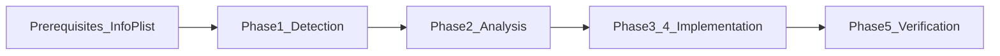

# Cursor で使う app-resizability スキル — できることと使い方

## はじめに

折りたたみ iPhone（iPhone Duo）や、実行中にウィンドウサイズが変わる iOS 環境向けに、Apple は [Prepare - iPhone Duo](https://developer.apple.com/iphone-duo/prepare/) で次の流れを案内しています。

1. コーディングアシスタントに **「get my app ready for iPhone Duo」** と頼む（専用スキルがプロジェクトを走査する）
2. Step 2 のパターンを手動でも確認する
3. Device Hub などでリサイズをテストする

Xcode 以外のエージェント（Cursor など）向けには、ターミナルから `xcrun agent skills export` でスキル定義を書き出し、エージェントのスキル置き場に置く方法が同ページに記載されています。

**iPhoneDuoDemo** リポジトリでは、公式スキル **`app-resizability`** を次に配置しています。

- 本体: [`.cursor/skills/app-resizability/SKILL.md`](../.cursor/skills/app-resizability/SKILL.md)
- 詳細タスク: [`.cursor/skills/app-resizability/references/`](../.cursor/skills/app-resizability/references/)

この記事は、Cursor Agent がそのスキルで **何をしてくれるか**、**どう頼むか**、**限界は何か** をまとめた解説用テキストです。

---

## スキルとは（Cursor 文脈）

Cursor の Agent Skills は、`SKILL.md` に書かれた **手順・ルール・チェックリスト** です。チャットで関連する依頼をすると、Agent がスキルを読み、Apple が定義したワークフローに沿って動きます。

重要な点:

- スキルは **AI の常時知識の代わりではない**（プレイブックに近い）
- 主対象は **UIKit 混在アプリのレガシー API 除去と Scene 対応**
- SwiftUI の Duo 専用 API（`ArrangementView`、`onHingeChange` など）の設計指導は **別枠**

---

## いつ使うか（トリガー例）

`app-resizability` は、次のような依頼で有効化されます。API 名を出さなくても構いません。

| 例（英語） | 例（日本語） |
|------------|--------------|
| Get my app ready for iPhone Duo | iPhone Duo 向けに準備して |
| Optimize this app for the foldable iPhone | 折りたたみ iPhone 向けに最適化して |
| Make this app resize properly | ウィンドウのリサイズに耐えるようにして |

スキルが想定する状況:

- 折りたたみ iPhone Duo 向けの準備・最適化
- **実行中**にアプリウィンドウのサイズが変わる環境（Split View、Stage Manager、リサイズ可能なシーン）
- スキル Scope に列挙された非推奨 API の利用

iPhone Duo は「画面サイズが変わる」代表例のため、Duo 向け依頼は **Task Registry の全タスク** を対象にする、とスキル本体に明記されています。

---

## Agent が実行する処理（ワークフロー概要）

スキルはおおむね次の順で進みます。



| 段階 | 内容 |
|------|------|
| **Prerequisites** | `Info.plist` とビルド設定を **読むだけ**（3 項目）。問題があれば報告 |
| **Phase 0（Fast Path）** | 単純な `UIScreen.main.scale` などは即置換 |
| **Phase 1: Detection** | Task Registry 各タスクの検出パターンでコードを探索 |
| **Phase 2: Analysis** | クラス種別・ライフサイクル・意図を文脈から判断 |
| **Phase 3–4: Decision / Implementation** | 安全な 1:1 置換は適用。曖昧・大規模変更はユーザーに確認 |
| **Phase 5: Verification** | 検出した全ファイルに diff またはスキップ理由があるか監査 |

大規模リポジトリでは、ファイルを **1 件ずつ／小バッチ** で処理し、見落としを防ぐ手順もスキルに含まれています。

---

## Prerequisites（プロジェクト設定の 3 チェック）

コードを触る **前に**、次を確認します。**キーの追加・削除・値の変更は行いません**（報告のみ）。

| チェック | 満たしている条件 | 未充足時に報告すること |
|----------|------------------|----------------------|
| **Launch Screen** | `UILaunchScreen` / `UILaunchScreens` / `UILaunchStoryboardName` / `UILaunchStoryboards` / `INFOPLIST_KEY_UILaunchScreen_Generation` のいずれか | 起動画面未宣言 → App Store で `ITMS-90870` のリスク。[TN3208](https://developer.apple.com/documentation/technotes/tn3208-preparing-your-apps-launch-screen-to-meet-app-store-requirements) を参照 |
| **iPad 向き** | iPad 用宣言が 4 向きすべて、または未宣言 | 欠けている向きを列挙。`supportedInterfaceOrientations` のオーバーライドは未調査である旨も記載。iPhone の縦固定は通常問題なし |
| **UIRequiresFullScreen** | キーが無い、または `UIRequiresFullScreenIgnoredStartingWithVersion` が既に設定済み | `UIRequiresFullScreen` あり → iOS 27 では無視されるが移行注意。[TN3192](https://developer.apple.com/documentation/technotes/tn3192-migrating-your-app-from-the-deprecated-uirequiresfullscreen-key) を参照 |

`UIRequiresFullScreen` について、スキルは **勝手に削除も追加もしない** と明記しています（削除すると即リサイズ可能になりレイアウトが崩れる可能性、`IgnoredStartingWithVersion` の値は開発者判断）。

依頼が **特定ファイルのみ** を指す場合、Prerequisites はスキップされます。

---

## Task Registry（5 つのコード修正タスク）

コードベースに適用されるタスクは、上から順に **独立した 5 タスク** です。各タスクの詳細は `references/` 内の Markdown にあります。

| タスク | 参照ファイル | 主な対象 | 置き換えの意図 |
|--------|--------------|----------|----------------|
| UIScreen.main の近代化 | [uiscreen-task.md](../.cursor/skills/app-resizability/references/uiscreen-task.md) | `UIScreen.main` / `UIScreen.mainScreen` | 画面サイズ・scale を **そのビュー／ウィンドウ／trait** から取得 |
| 向き（orientation）の近代化 | [orientation-task.md](../.cursor/skills/app-resizability/references/orientation-task.md) | `interfaceOrientation` 等 | レイアウトを **向きではなく size class や bounds の幅・高さ** で決める |
| Scene ライフサイクル | [scene-lifecycle-task.md](../.cursor/skills/app-resizability/references/scene-lifecycle-task.md) | AppDelegate 中心の構成 | **Scene ベース** ライフサイクルへ移行 |
| Safe Area | [safe-area-task.md](../.cursor/skills/app-resizability/references/safe-area-task.md) | `topLayoutGuide` / `bottomLayoutGuide`、固定 inset | **非対称・変動する** safe area に対応 |
| Idiom | [idiom-task.md](../.cursor/skills/app-resizability/references/idiom-task.md) | `userInterfaceIdiom`、phone/pad 分岐 | **idiom ではなく size class**。必要な idiom はローカル trait から |

対象言語: **Swift と Objective-C** の両方。

スキル Scope で列挙される主なレガシー要素:

- main screen（`UIScreen.main`）
- interface orientation
- user interface idiom
- 対称 safe area 前提
- application lifecycle のみ（`UIApplicationDelegate` に依存しすぎ）

---

## 修正時のルール（読者向け要約）

Agent には Core Principles として、次が強く求められます。

1. **消費地点に近い情報を使う**（例: ウィンドウよりビューの trait collection）
2. **対象 API があるのに TODO だけ／空 diff は不可** — 参照ファイルに従い **実際に置換**
3. **グローバル逃げ禁止** — `UIApplication.shared` / `UIDevice.current` / `UIScreen.main` を「新しい答え」に使わない
4. **動的値をリテラルにしない**
5. **`if`/`else` など制御フローを壊さない**
6. **スコープ外のリファクタ・整形をしない**
7. **複数パートのパターンは原子単位で完遂**（API 置換 + trait 変更の監視など）
8. **挙動が変わりうる変更は先にユーザーに確認**

---

## Cursor での使い方

1. **iPhoneDuoDemo**（またはスキルを置いたプロジェクト）を Cursor で開く
2. **Agent モード**のチャットを開く（**新規チャット**推奨 — スキル一覧の反映）
3. 例として次のように依頼する:

```
get my app ready for iPhone Duo
```

```
app-resizability スキルに従って、このプロジェクトをチェックして
```

```
UIScreen.main や向き・idiom 依存がないかスキャンして
```

Agent は `.cursor/skills/app-resizability/SKILL.md` を読み、必要に応じて `references/*.md` を参照して検出・修正・報告を行います。

---

## スキルの再取得・更新

Apple が Xcode 側でスキルを更新した場合、ターミナルで再 export し、プロジェクト内のフォルダを差し替えます。

```bash
xcrun agent skills export \
  --output-dir /path/to/staging/skills \
  --replace-existing
```

export 結果の `app-resizability` フォルダを、リポジトリの `.cursor/skills/app-resizability` に **移動または上書き** してください（他スキルだけ個人の `~/.cursor/skills` に置く運用も可能）。

---

## この iPhoneDuoDemo で期待できる結果

本リポジトリは **SwiftUI 中心**（例: [ContentView.swift](../iPhoneDuoDemo/ContentView.swift) の `onHingeChange`）で、UIKit の `UIScreen.main` や AppDelegate 前提のコードはほぼありません。

そのためスキルを走らせると:

- **Prerequisites**（Launch Screen 等）の報告は出る可能性がある
- **Task Registry によるコード修正は「該当なし」に近い** 結果になりやすい

Prepare ページ Step 2 と **思想は同じ**（固定画面・向き・idiom 前提をやめる）ですが、**Duo 向け SwiftUI レイアウト**（`ArrangementView`、縦タブ、`Tab` API の書き方など）は、このスキルの主戦場ではありません。README の学習メモと併用してください。

---

## できないこと・限界

- **すべての Duo 問題を自動検出する** — Apple も Prepare では Step 2 の手動確認を推奨
- **Device Hub の操作手順**（ヒンジスライダーは Option キーなど）や **SwiftUI Tab のチュートリアル**
- **Duo 専用 UI の自動設計**（ArrangementView の配置方針、Reserved Region など）
- **Preview や非 Duo シミュレータ**でのヒンジ・リサイズ挙動の検証代行

UIKit が多い既存アプリほど、スキルの **検出と機械的置換** の効果が大きくなります。

---

## 参考リンク

| リソース | URL / パス |
|----------|------------|
| Prepare - iPhone Duo | https://developer.apple.com/iphone-duo/prepare/ |
| スキル本体 | [../.cursor/skills/app-resizability/SKILL.md](../.cursor/skills/app-resizability/SKILL.md) |
| リポジトリ README（Duo API 学習メモ） | [../README.md](../README.md) |
| ヒンジ API（参考・スキル外） | [Leverage multiple displays and scenes on iPhone Duo](https://developer.apple.com/videos/play/tech-talks/111464/) |

---

*記事用テキスト — iPhoneDuoDemo / app-resizability*
